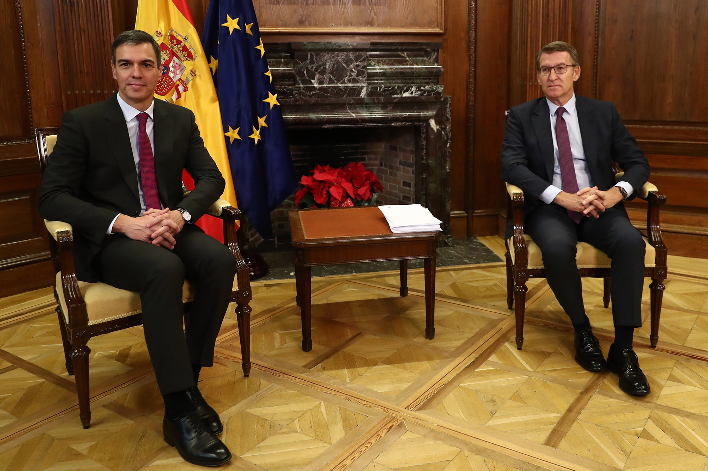
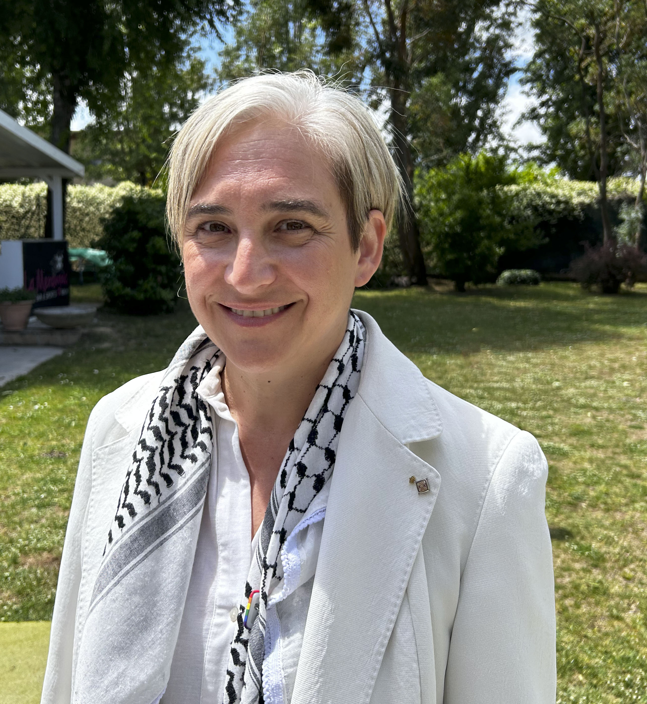

**ESPAÑA · ELECCIONES**

**Debate electoral en España: el presidente y la izquierda acorralaron al líder de la oposición, y una palabra se adueñó de la noche**

*El jefe del Gobierno socialista y la candidata de una coalición de izquierda hicieron frente común contra el líder conservador de la oposición en el último debate por televisión antes de las elecciones del domingo 29, mientras la extrema derecha evitó atacarlo. Las encuestas dan como favoritos a conservadores y ultraderechistas para sumar la mayoría que permite elegir al próximo jefe de Gobierno, pero lo que marcó la noche fue una palabra: «calladita».*

*Pedro Sánchez, presidente del Gobierno, y Alberto Núñez Feijóo, líder del Partido Popular, al inicio de una reunión en el Congreso de los Diputados, el 22 de diciembre de 2023.*

Foto: Pool Moncloa/Fernando Calvo. Ministerio de la Presidencia. Gobierno de España (https://www.lamoncloa.gob.es/multimedia/galeriasfotograficas/presidente/Paginas/2023/221223-encuentro-sanchez-feijoo-congreso.aspx), vía Wikimedia Commons.

El último debate por televisión de la campaña española tuvo poco que ver con el de la semana anterior, que enfrentó solo a los dos principales candidatos. Esta vez fueron cuatro, y desde el comienzo se formaron dos bloques: el presidente y la candidata de la izquierda actuaron en conjunto, mientras la derecha y la extrema derecha no se atacaron en ningún momento.

Los protagonistas fueron Pedro Sánchez, presidente del Gobierno desde 2018 y candidato del Partido Socialista Obrero Español (PSOE), de centroizquierda; Alberto Núñez Feijóo, líder del Partido Popular (PP), conservador de centroderecha y principal fuerza de la oposición; Santiago Abascal, líder de Vox, partido de extrema derecha; y Ada Colau, exalcaldesa de Barcelona y candidata del Frente Amplio, una coalición de izquierda que reúne, entre otros, a Sumar, Izquierda Unida y Más Madrid.

El debate, el jueves 26 en Tres Cantos, cerca de Madrid, lo organizó la Academia de Televisión y lo moderó su presidenta, María Casado.

**Qué está en juego**

El domingo 29 de noviembre se eligen los 350 diputados del Congreso, que luego votan al presidente del Gobierno; la mayoría absoluta es de 176. Según el promedio de encuestas del diario *El País*, el PP obtendría el 31,4% de los votos; el PSOE, el 29,1%; Vox, el 17,9%; y el Frente Amplio y sus aliados, el 6,8%. La ventaja del PP sobre los socialistas se achicó en la campaña de casi seis puntos a poco más de dos, pero 20 de las 21 encuestadoras dan la mayoría a PP y Vox, y el modelo estadístico del diario calcula esa probabilidad en un 83%. Desde el lunes ya no pueden publicarse encuestas.

**La violencia contra las mujeres abrió el debate**

La tensión empezó en el primer minuto. Colau, que habló primero, pidió a los otros tres que condenaran los asesinatos de mujeres por violencia machista: «Las mujeres no vamos a parar y no vamos a callar hasta que las víctimas sean cero». Solo Sánchez y Feijóo lo hicieron. «¿No va a condenar la violencia?», le preguntó a Abascal, que se negó a «seguir ninguna orden» de quienes, dijo, han «condenado a las mujeres a la inseguridad». Sánchez agregó que Vox «no va a condenar la violencia porque no la reconoce».

**Vivienda y corrupción**

En vivienda, el tema que más pesó en la campaña, Feijóo acusó al Gobierno de haber reducido la oferta de alquileres con sus normas e impuestos: «Nosotros proponemos un millón de viviendas y ustedes hablan de un millón de excusas». Colau criticó la «receta de la derecha», pero también le exigió al PSOE medidas «valientes» si vuelven a gobernar juntos, como expropiar a los fondos de inversión que compran viviendas en masa, conocidos como fondos buitre. Abascal culpó a la inmigración y llamó a Sánchez «el gran buitre que hay en España». Colau salió en defensa del presidente: «Al presidente le acaba de insultar, usted se desacredita solo».

El momento más áspero llegó con la corrupción. «¿Qué tiene? ¿Un imán para la corrupción?», le preguntó Feijóo a Sánchez, que contestó con otra pregunta: «¿Con quién viajaba usted de vacaciones, señor Feijóo?». Más tarde, Sánchez le preguntó si reconocería el resultado electoral. Feijóo redobló la apuesta: se comprometió a dimitir si no llega a la presidencia del Gobierno y desafió a Sánchez a hacer lo mismo. «¿Asume usted la responsabilidad de dimitir después de las elecciones, dejar el acta de diputado y renunciar al aforamiento?», le dijo, en alusión a la protección judicial especial que tienen los diputados. Sánchez no respondió.

**«Y usted, calladita»**

El choque más comentado llegó con las inundaciones de octubre de 2024 en Valencia, que dejaron más de 230 muertos. Colau le reprochó a Feijóo que el expresidente del gobierno regional valenciano, Carlos Mazón, del PP, siga siendo diputado y conserve esa protección judicial ante investigaciones como la abierta por un juzgado de Paiporta: «¿Cómo me puede hablar usted de buena gestión cuando el PP aún mantiene a Mazón con cargo público aforado, con más de 230 víctimas mortales?».

Feijóo respondió: «Buena gestión es ponerse al frente de una emergencia nacional y no salir huyendo de Paiporta y usted, calladita. Esa es la buena gestión». La alusión a Paiporta, una de las localidades más afectadas, apuntaba a Sánchez, que durante una visita al lugar fue increpado por un grupo de vecinos. El «calladita», acompañado de un dedo sobre los labios, iba dirigido a Colau.

Sánchez intervino: «¿Por qué habla de calladita, señor Feijóo? Un poco de respeto. ¿Qué machismo es este?». Feijóo lo acusó de tergiversar sus palabras: «No manipule».

*Ada Colau, candidata del Frente Amplio, en el festival Encuentro de Castiglione del Lago (Italia), el 1 de junio de 2024.*

Foto: Robo71, dominio público (CC0), vía Wikimedia Commons.

Al terminar, ante la prensa, Feijóo pareció dar marcha atrás: «Si he molestado a alguien, lo retiro, pero ya está bien de hacer teatrillo. Hemos hecho un debate leal». Pero ya en la sede de su partido, en Madrid, insistió: «Han estado calladitos y calladitas durante tres años de corrupción y mirando para otros lados». Colau le respondió desde su propia sede: «Las mujeres tenemos la última palabra y vamos a ir en masa a votar y no a estar calladitas».

**Todos dijeron haber ganado**

Cada partido se declaró vencedor. Sánchez aseguró que «el bloque progresista ha ganado por goleada». Rebeca Torró, secretaria de organización del PSOE, afirmó: «Nosotros, el Partido Socialista, no queremos a las mujeres 'calladitas'». Pablo Bustinduy, ministro de Consumo y dirigente del Frente Amplio, sostuvo que Colau «ha dominado la conversación». Borja Sémper, portavoz del PP, se mostró «muy satisfecho»: «Si la semana pasada vimos a un Pedro Sánchez desganado, hoy lo hemos visto desesperado». Ignacio Garriga, secretario general de Vox, dijo que entre Sánchez y Colau «estaba todo compinchado».

Los analistas del diario barcelonés *La Vanguardia* no vieron un ganador claro. Josep Martí Blanch habló de una «noche de parejitas»: Sánchez y Colau «funcionaron como un matrimonio», mientras que Abascal y Feijóo en público «no intercambian palabra». No vio «vencedores ni vencidos individuales», pero sí «ventaja para la izquierda» como bloque. Isabel Garcia Pagan consideró que Colau «se ganó el espacio que las encuestas le niegan» y que el «usted, calladita» perseguirá a Feijóo. Jaume V. Aroca destacó «lo mal que se le dio el debate a Santiago Abascal». José María Lassalle resumió el panorama: «Feijóo aparece como favorito para gobernar, aunque dependerá del apoyo incómodo de Abascal».

**Fuentes consultadas**

- RTVE, Irene Fedriani Fernández, «Sánchez recupera el tono contra Feijóo en un áspero debate con Colau de aliada y sin ataques entre PP y Vox», 27/11/2026. https://www.rtve.es/noticias/20261127/debate-electoral-cuatro-elecciones-generales-2026-cronica/17331240.shtml
- RTVE, «El "calladita" de Feijóo a Colau marca las reacciones postdebate», 27/11/2026. https://www.rtve.es/noticias/20261127/sanchez-feijoo-abascal-colau-reacciones-debate-calladita/17332954.shtml
- El País, «Debate electoral 29-N a cuatro» (directo), 26-27/11/2026. https://elpais.com/espana/elecciones-generales/2026-11-26/debate-electoral-29-n-a-cuatro-entre-sanchez-feijoo-abascal-y-colau-en-directo.html
- El País, Kiko Llaneras y Borja Andrino, «¿Quién va a ganar las elecciones? La probabilidad de cada mayoría según las encuestas», 26/11/2026. https://elpais.com/espana/elecciones-generales/2026-11-26/quien-va-a-ganar-las-elecciones-la-probabilidad-de-cada-mayoria-segun-las-encuestas.html
- Cadena SER, «"En el PSOE no queremos a las mujeres 'calladitas'": las reacciones de los grupos al debate a cuatro», 27/11/2026. https://cadenaser.com/nacional/2026/11/26/en-el-psoe-no-queremos-a-las-mujeres-calladitas-las-reacciones-de-los-grupos-al-debate-a-cuatro-cadena-ser/
- Cadena SER, «Feijóo manda callar a Ada Colau y luego lo retira», 26/11/2026. https://cadenaser.com/video/nacional/2026/11/26/y-usted-calladita-nunez-feijoo-carga-contra-ada-colau-y-sanchez-le-acusa-de-machismo-cadena-ser/
- Europa Press, «Sánchez tacha de "machista" a Feijóo por decirle a Colau: "Y usted, calladita"», 27/11/2026. https://www.europapress.es/nacional/noticia-feijoo-carga-contra-gestion-sanchez-dana-dirige-colau-usted-calladita-20261126232740.html
- Europa Press, «Sánchez felicita a Colau y da ganador al bloque progresista frente al "machismo" de Feijóo y Abascal», 27/11/2026. https://www.europapress.es/nacional/noticia-sanchez-felicita-colau-da-ganador-bloque-progresista-frente-machismo-feijoo-abascal-20261127010934.html
- La Vanguardia, «¿Quién ha ganado el debate a cuatro?», 27/11/2026. https://www.lavanguardia.com/politica/20261127/11694321/ganado-debate-cuatro.html
