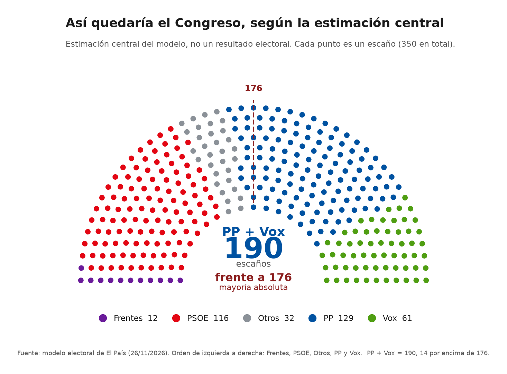
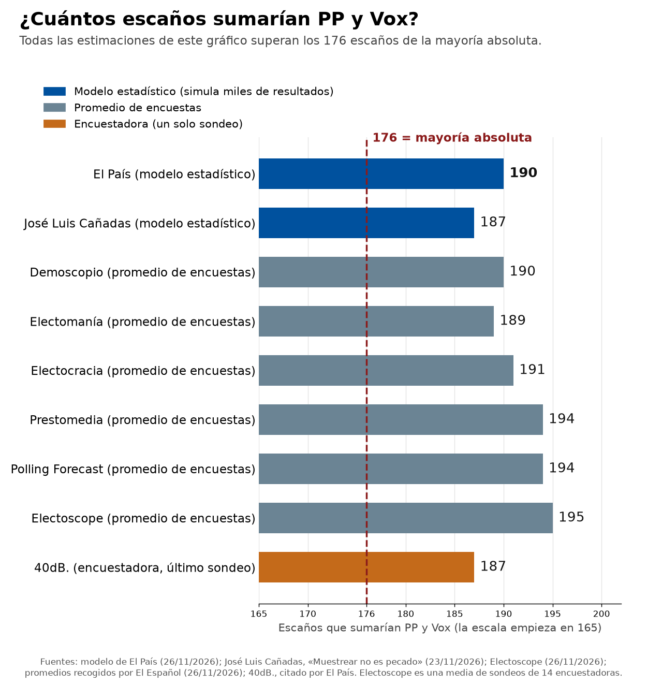
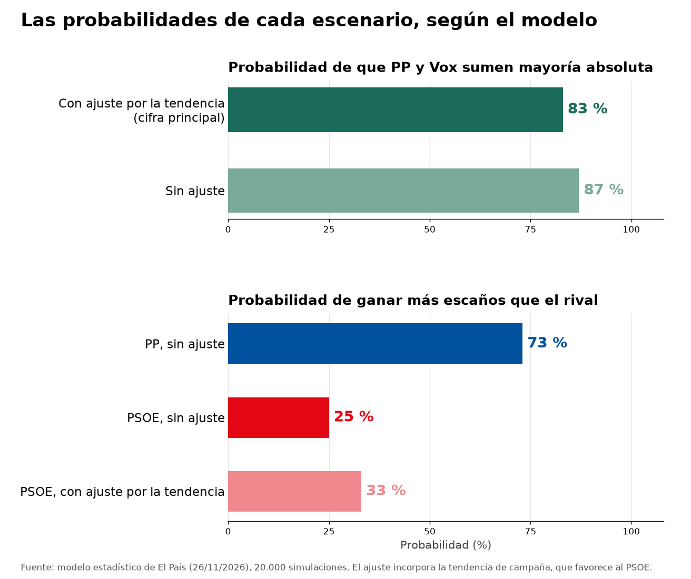

**ESPAÑA · ELECCIONES**

**La derecha española llega a las elecciones como favorita para sumar la mayoría absoluta**

*Un modelo estadístico calcula en un 83% la probabilidad de que el Partido Popular, de centroderecha, y Vox, de extrema derecha, reúnan juntos al menos 176 de los 350 diputados el domingo 29 de noviembre. Esa mayoría les permitiría elegir a un nuevo presidente del Gobierno y poner fin a los ocho años del socialista Pedro Sánchez en el poder.*

*Ilustración generada con inteligencia artificial, no es una fotografía: Alberto Núñez Feijóo (izquierda), líder del Partido Popular, y Santiago Abascal, líder de Vox, en el Congreso de los Diputados.*

Foto: ilustración de la redacción, hecha con IA.

A tres días de las elecciones generales en España, el escenario más probable es que el Partido Popular (PP) y Vox consigan juntos la mayoría absoluta del Congreso de los Diputados, la cámara que elige al presidente del Gobierno, es decir, al jefe del Poder Ejecutivo. El modelo estadístico del diario El País, elaborado por los periodistas de datos Kiko Llaneras y Borja Andrino y publicado este jueves, cifra esa posibilidad en un 83%.

El PP, partido conservador de centroderecha, es la principal fuerza de la oposición y lo encabeza Alberto Núñez Feijóo. Vox, de extrema derecha, está liderado por Santiago Abascal. Enfrente está el Partido Socialista Obrero Español (PSOE), de centroizquierda, cuyo candidato es Pedro Sánchez, presidente del Gobierno desde 2018. A su izquierda compite el Frente Amplio, una coalición de izquierda que reúne, entre otros, a Sumar, Izquierda Unida y Más Madrid, con la exalcaldesa de Barcelona Ada Colau como candidata.

El cálculo no es un recuento de votos, sino una estimación de probabilidades basada en las encuestas publicadas hasta el lunes 23, porque la ley electoral española prohíbe difundir sondeos desde el 24 de noviembre hasta el cierre de la votación.

**Una ventaja que se achica**

Según el promedio de encuestas del modelo, el PP obtendría el 31,4% de los votos; el PSOE, el 29,1%; Vox, el 17,9%; y el Frente Amplio y sus listas aliadas, el 6,8%. La ventaja del PP sobre los socialistas se redujo durante la campaña: pasó de casi seis puntos a algo más de dos.

Aun así, PP y Vox suman cerca del 49% de los votos, y el modelo estima que les bastaría con alrededor del 47% para llegar a 176 diputados.

En el escenario central, el PP lograría 129 escaños; el PSOE, 116; Vox, 61; y el Frente Amplio y sus aliados, 12. El resto de los partidos sumaría 32. PP y Vox llegarían así a unos 190 diputados, 14 más de los necesarios. El gráfico 1 muestra cómo quedaría el Congreso.

*Gráfico 1. Reparto de los 350 escaños del Congreso en la estimación central del modelo; no es un resultado electoral. "Frentes" agrupa al Frente Amplio y sus listas aliadas. Fuente: modelo estadístico de El País.*

Ese reparto es solo el punto medio de muchos resultados posibles. En ocho de cada diez simulaciones, el PP obtiene entre 112 y 146 escaños; el PSOE, entre 100 y 133; y Vox, entre 44 y 75. El cálculo tiene en cuenta los errores que cometieron las encuestas en el pasado y el sistema electoral español, que reparte los escaños por provincia y deja fuera a las listas que no alcanzan el 3% de los votos en cada una.

Otros cálculos llegan a una conclusión parecida. Cinco promedios de encuestas —Demoscopio, Electomanía, Prestomedia, Polling Forecast y Electocracia— ubican al PP por encima de los 125 escaños y a la suma con Vox entre 189 y 194. El gráfico 2 compara esas cifras con las de otros modelos y con la última encuesta de la consultora 40dB.

*Gráfico 2. Escaños que sumarían PP y Vox según cada modelo estadístico, promedio de encuestas y encuestadora, frente a los 176 de la mayoría absoluta.*

**Cómo funciona el modelo**

El modelo simula la elección 20.000 veces con los datos de las encuestas y con el margen de error que estas tuvieron en 44 elecciones desde 1986. La probabilidad de cada escenario es la proporción de simulaciones en las que se produce.

En el 87% de esas simulaciones, PP y Vox —contando la lista conjunta del PP con Unión del Pueblo Navarro, un partido regional de derecha— llegan a 176 escaños. En un 7%, la mayoría la alcanzan el PSOE y los partidos que apoyaron a Sánchez en 2023, aun sin contar a Junts, el partido independentista catalán de centroderecha. En el 6% restante, ningún bloque llega y la llave quedaría en manos de Junts. El cálculo supone que Coalición Canaria, un partido regionalista de las islas Canarias, se mantiene del lado del PSOE; en un 1,5% de los casos, sus diputados podrían completar la mayoría de PP y Vox.

Ese 87% es el dato sin corregir. Los autores lo rebajan al 83% porque en las últimas semanas las encuestas se movieron hacia la izquierda y, según su análisis de 37 elecciones anteriores, el resultado final suele desviarse en esa misma dirección. Con esa cifra, la mayoría de la derecha no se concretaría aproximadamente en una de cada seis simulaciones.

Otras señales van en la misma línea. Un cálculo con las respuestas individuales de las encuestas de 40dB. sitúa la probabilidad entre el 81% y el 85%; los mercados de predicción, donde se apuesta dinero sobre el resultado, la ubican en el 88%; y 20 de las 21 encuestadoras que publicaron sondeos en la última semana dan la mayoría a PP y Vox. El modelo del estadístico José Luis Cañadas la estima en un 87,7%, y el promedio Polling Forecast, en un 96%.

La gran excepción es el Centro de Investigaciones Sociológicas (CIS), el instituto público de encuestas, que no estima escaños y da al PSOE una ventaja de 9,7 puntos sobre el PP: 34,4% contra 24,7%. Además, hay un antecedente que invita a la cautela: en las elecciones de 2023, PP y Vox se quedaron en 170 escaños, seis por debajo de la mayoría, pese a que la mayor parte de las encuestas de campaña se la daban.

**Quién queda primero**

La pelea por el primer puesto está más abierta. El PP obtiene más escaños que el PSOE en el 73% de las simulaciones, y los socialistas quedan por delante en el 25%. Si se incorpora la tendencia de campaña, las posibilidades del PSOE suben al 33%. En un 4% de los casos, el PSOE gana en votos, pero el PP consigue más diputados. Demoscopio calcula en un 71,9% la probabilidad de que el PP sea la primera fuerza.

*Gráfico 3. Probabilidad de que PP y Vox sumen la mayoría absoluta y de que cada uno de los dos grandes partidos gane más escaños que el otro. Fuente: modelo estadístico de El País.*

Entre los partidos más pequeños, muchos de ellos nacionalistas o independentistas regionales, el modelo prevé unos 10 escaños para Esquerra Republicana de Catalunya (independentistas catalanes de izquierda); 7 para EH Bildu (independentistas vascos de izquierda); 4 para Junts y otros 4 para Adelante Andalucía (izquierda regionalista andaluza); 3 para el Partido Nacionalista Vasco (centroderecha); y 2 para el Bloque Nacionalista Galego (izquierda). Podemos, de izquierda, obtendría representación en el 43% de las simulaciones, mientras que la plataforma populista Se Acabó La Fiesta quedaría fuera del Congreso en el 79%.

El domingo, la cifra que habrá que mirar es 176. El escenario más probable favorece a PP y Vox, pero, con el ajuste del modelo, una de cada seis veces esa mayoría no llega.

**Datos clave**

• Elecciones generales: domingo 29 de noviembre de 2026. Se eligen los 350 diputados del Congreso; la mayoría absoluta es de 176.

• Desde el 24 de noviembre, la ley prohíbe publicar encuestas.

• Estimación central del modelo de El País: PP 129, PSOE 116, Vox 61, Frente Amplio y aliados 12, otros 32. PP y Vox sumarían unos 190.

• Márgenes del modelo (ocho de cada diez simulaciones): PP 112-146, PSOE 100-133, Vox 44-75.

• Probabilidad de mayoría de PP y Vox: 83% con ajuste por la tendencia; 87% sin ajuste.

• Primer puesto en escaños: PP 73%, PSOE 25% (33% con la tendencia).

• Cinco promedios de encuestas ubican la suma de PP y Vox entre 189 y 194. El CIS, que no estima escaños, da ventaja al PSOE.

**Fuentes consultadas**

- El País, Kiko Llaneras y Borja Andrino, «¿Quién va a ganar las elecciones? La probabilidad de cada mayoría según las encuestas», 26/11/2026.
- El Español, Íñigo Zulet, «Cinco promedios de encuestas pronostican que el PP ganará las elecciones y que habrá mayoría holgada de la derecha», 26/11/2026.
- Electoscope, agregador de encuestas, consultado el 26/11/2026.
- José Luis Cañadas Reche, «Generales 2026: el pronóstico vivo del 29-N», Muestrear no es pecado, 23/11/2026.
- Qué!, Gonzalo Rubio, «Las encuestas del 29N dan la victoria a Feijóo y mayoría absoluta a PP y Vox, salvo el CIS», 24/11/2026.
- RTVE, «Ada Colau, la candidata de Frente Amplio...», 12/11/2026, y «Pedro Sánchez, el candidato del PSOE...», 12/11/2026.
